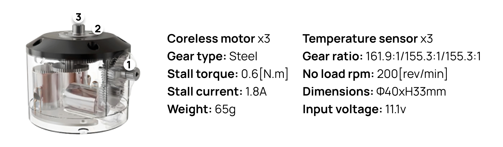

# MD-300-150

> 

The MD-300-150 is a 3-in-1 smart actuator: three coreless-DC servos driven by one controller board. Each servo reports its position, current and temperature, and can switch between two control algorithms at run time.

> [!NOTE]
> This page describes **firmware 0.0.9** with the **SPI** interface. A TTL (UART) interface is in development and will be documented when it is released.

## Contents

- [Specifications](#specifications)
  - [Dimensions](#dimensions)
- [Safety Information](#safety-information)
- [Performance](#performance)
- [Control Table](#control-table)
  - [Area (EEPROM, RAM)](#area-eeprom-ram)
  - [Size](#size)
  - [Access](#access)
  - [Initial Value](#initial-value)
  - [Control Table of EEPROM Area](#control-table-of-eeprom-area)
  - [Control Table of RAM Area](#control-table-of-ram-area)
  - [Control Table Description](#control-table-description)
- [Operating Modes](#operating-modes)
- [Connector Information](#connector-information)
- [Communication (SPI)](#communication-spi)
- [Motion Profile](#motion-profile)
- [Drawings](#drawings)

## Specifications

| Item                   | Specifications |
| ---------------------- | -------------- |
| MCU                    | ARTERY AT32F413, ARM Cortex-M4F (192 [MHz], 32Bit), one MCU for the 3 servos |
| Position Sensor        | Potentiometer (12Bit ADC, 310 [°]) |
| Sensor                 | Current, Temperature (NTC) |
| Motor                  | Coreless x3 |
| Communication          | SPI slave, 12 [MHz] TTL: in development |
| Control Algorithm      | Position PID → PWM, or Position PD → current loop → PWM (selectable) |
| Resolution             | 4096 [steps] over 310 [°] (≈ 0.076 [°]) |
| Operating Modes        | Position Control Mode (0 ~ 310 [°]) Current-based Position Control Mode Current Control Mode PWM Control Mode (Voltage Control Mode) |
| Weight                 | 65 [g] |
| Dimensions             | **Ø40.0 x 33.35** [mm] (body) 49.2 x 37.4 [mm] (maximum, including the output shafts) |
| Gear Ratio             | 161.9 : 1 / 155.3 : 1 / 152.7 : 1 |
| Stall Torque           | 0.5 [N.m] (at 9 [V], 0.7 [A], 0.71 [Nm/A]) **0.6 [N.m] (at 11.1 [V], 0.8 [A], 0.75 [Nm/A])** 0.7 [N.m] (at 14.8 [V], 0.9 [A], 0.78 [Nm/A]) |
| No Load Speed          | 99 / 100 / 101 [rev/min] (at 7.4 [V]) **150 / 152 / 153 [rev/min] (at 11.1 [V])** 206 / 209 / 209 [rev/min] (at 14.8 [V]) |
| Operating Temperature  | -5 ~ +70 [°C] |
| Input Voltage          | 9.0 ~ 12.6 [V] (**Recommended: 11.1 [V]**) |
| Command Signal         | Digital Packet |
| Physical Connection    | SPI, 6-pin (VIN, GND, MOSI, SCK, MISO, CS) TTL: ongoing |
| ID                     | One chip-select line per module, servo 1 ~ 3 inside the module |
| Feedback               | Position, Current, Temperature On request: setpoint, errors, PWM duty, mode, raw sensor readings |
| Case Material          | Engineering Plastic |
| Gear Material          | Steel & Engineering Plastic |
| Standby Current        | 50 [mA] |

### Dimensions

## Safety Information

> [!CAUTION]
> **DANGER.** Ignoring these warnings may cause serious injury or death.
>
> - Keep water, flammable items, open flames and solvents away from the product.
> - Keep fingers and other body parts away from the product while it is running.
> - If the product gives off a strange smell, noise or smoke, stop and remove power.
> - Keep the product out of reach of children.
> - Check the input polarity before connecting or powering the cables.

> [!CAUTION]
> Ignoring these warnings may cause mild injury or damage to the product.
>
> - Stay within the specified input voltage, current and operating temperature.
> - Do not put blades or other sharp objects into the product while it is running.

> [!IMPORTANT]
> Ignoring these warnings may damage the product.
>
> - Do not drop the product or hit it hard.
> - Do not connect or disconnect cables while power is on.

## Performance

**Performance graph (torque vs. speed and current): to be measured.**

## Control Table

The Control Table lists every value a servo stores or reports. Each of the 3 servos in a module has its own copy. The host writes values to control the servo and reads values to monitor it.

> [!NOTE]
> The SPI interface has no byte-addressed memory. The **No.** column numbers the items for reference; the **SPI** column says where each item travels on the bus (see [Communication (SPI)](#communication-spi)):
> `CFG n` = configuration ID n, `LIVE n` = live-value ID n, `CMD +n` / `FB +n` = byte n of the servo's block in the command / feedback frame.

### Area (EEPROM, RAM)

The Control Table is divided into two areas. Data in the **EEPROM area** (No. 0 ~ 12) is non-volatile: once stored with the SAVE command, it is kept in the flash memory of the module even when the power is turned off. Data in the **RAM area** (No. 13 ~ 31) is volatile and returns to its initial value every time the power is turned on.

> [!NOTE]
> A new value written to the EEPROM area takes effect immediately, but it is only kept after a power cycle once the SAVE command has been sent. The RESTORE command reloads the factory default values.

### Size

The size of each data item is given in bytes. Configuration values and live values are transferred as 4-byte floating-point numbers. Command and feedback values are transferred as 2-byte integers. Data larger than 1 byte is sent in [Little Endian](https://en.wikipedia.org/wiki/Endianness#Little) byte order.

> [!NOTE]
> Two's complement is applied to negative integer values. For more information, please refer to [Two's complement](https://en.wikipedia.org/wiki/Two%27s_complement) on Wikipedia.

### Access

Each data item in the Control Table has one of three access properties:

| Access | Description |
| ------ | ----------- |
| RW | Read and write. The value can be read with the GET command and changed with the SET command. Used to configure the device. |
| W | Write. The value is written by the host in every command frame. Used to control the device. |
| R | Read only. The value is reported in the feedback frame or read with the GET_LIVE command, and cannot be changed by the host. Used for measurement and monitoring. |

### Initial Value

The Initial Value is the value each data item holds when the device is turned on. In the EEPROM area, the initial values listed in the Control Table are the factory default settings; if a user changes a value and stores it with the SAVE command, the stored value becomes the new initial value at the next power-up. In the RAM area, the initial values are restored every time the device is turned on.

### Control Table of EEPROM Area

| No. | Size(Byte) | Data Name | Access | Initial Value | Range | Unit | SPI |
| --- | ---------- | --------- | ------ | ------------- | ----- | ---- | --- |
| 0  | 4 | [Reverse Position Sensor](#reverse-position-sensor0) | RW | 1 / 0 / 1 \* | 0 ~ 1 | - | CFG 0 |
| 1  | 4 | [Min Position ADC](#minmax-position-adc1-2) | RW | 0 | 0 ~ 4,095 | ADC count | CFG 1 |
| 2  | 4 | [Max Position ADC](#minmax-position-adc1-2) | RW | 4,096 | 0 ~ 4,096 | ADC count | CFG 2 |
| 3  | 4 | [Range Position](#range-position3) | RW | 310 | 0 ~ 360 | ° | CFG 3 |
| 4  | 4 | [Reverse Motor](#reverse-motor4) | RW | 0 / 1 / 1 \* | 0 ~ 1 | - | CFG 4 |
| 5  | 4 | [Position P Gain](#position-pid-gain5-6-10) | RW | 80 | ≥ 0 | see description | CFG 5 |
| 6  | 4 | [Position D Gain](#position-pid-gain5-6-10) | RW | 640 | ≥ 0 | see description | CFG 6 |
| 7  | 4 | [Current P Gain](#current-gain7-8) | RW | 0.0006 | ≥ 0 | duty/mA | CFG 7 |
| 8  | 4 | [Current Feed-forward Gain](#current-gain7-8) | RW | 0.00022 | ≥ 0 | duty/mA | CFG 8 |
| 9  | 4 | [PWM Limit](#pwm-limit9) | RW | 0.90 | 0 ~ 1 | duty | CFG 9 |
| 10 | 4 | [Position I Gain](#position-pid-gain5-6-10) | RW | 0 | ≥ 0 | see description | CFG 10 |
| 11 | 4 | [Control Mode](#control-mode11) | RW | 1 | 0 ~ 1 | - | CFG 11 |
| 12 | 4 | [PWM Scale](#pwm-scale12) | RW | 0.001 | ≥ 0 | duty/PID unit | CFG 12 |

\* factory value of servo 1 / servo 2 / servo 3 of the module.

### Control Table of RAM Area

| No. | Size(Byte) | Data Name | Access | Initial Value | Range | Unit | SPI |
| --- | ---------- | --------- | ------ | ------------- | ----- | ---- | --- |
| 13 | 2 | [Goal Mode](#goal-mode13) | W | 0 | 0 ~ 2 | - | CMD +0 |
| 14 | 2 | [Goal Position](#goal-position14) | W | - | 0 ~ 3,100 | 0.1 ° | CMD +2 |
| 15 | 2 | [Goal Current / Current Limit](#goal-current--current-limit15) | W | 0 | -32,768 ~ 32,767 | mA | CMD +4 |
| 16 | 2 | [Present Position](#present-position16-22) | R | - | 0 ~ 3,100 | 0.1 ° | FB +2 |
| 17 | 2 | [Present Current](#present-current17-26) | R | - | -32,768 ~ 32,767 | mA | FB +4 |
| 18 | 2 | [Present Temperature](#present-temperature18-31) | R | - | - | 0.1 °C | FB +6 |
| 19 | 4 | [Position Input ADC](#position--current-input-adc19-20) | R | - | 0 ~ 4,095 | ADC count | LIVE 0 |
| 20 | 4 | [Current Input ADC](#position--current-input-adc19-20) | R | - | 0 ~ 4,095 | ADC count | LIVE 1 |
| 21 | 4 | [Setpoint Position](#setpoint-position21-position-error23) | R | - | - | ° | LIVE 2 |
| 22 | 4 | [Present Position (float)](#present-position16-22) | R | - | - | ° | LIVE 3 |
| 23 | 4 | [Position Error](#setpoint-position21-position-error23) | R | - | - | ° | LIVE 4 |
| 24 | 4 | [Current Limit (in use)](#goal-current--current-limit15) | R | - | - | mA | LIVE 5 |
| 25 | 4 | [Controller Output](#controller-output25) | R | - | - | mA / PID unit | LIVE 6 |
| 26 | 4 | [Present Current (float)](#present-current17-26) | R | - | - | mA | LIVE 7 |
| 27 | 4 | [Current Error](#current-error27) | R | - | - | mA | LIVE 8 |
| 28 | 4 | [Present PWM](#present-pwm28) | R | - | -1 ~ 1 | duty | LIVE 9 |
| 29 | 4 | [Present Mode](#goal-mode13) | R | - | 0 ~ 2 | - | LIVE 10 |
| 30 | 4 | [Loop Counter](#loop-counter30) | R | - | - | - | LIVE 11 |
| 31 | 4 | [Present Temperature (float)](#present-temperature18-31) | R | - | - | °C | LIVE 12 |

### Control Table Description

#### Reverse Position Sensor(0)

Sets which way the potentiometer counts.

| Value | Description |
| ----- | ----------- |
| 0 | Normal |
| 1 | Reversed |

> [!WARNING]
> Set it together with [Reverse Motor(4)](#reverse-motor4). If only one of the two is wrong, the servo pushes the wrong way and runs into its end stop.

#### Min/Max Position ADC(1, 2)

The potentiometer readings that correspond to 0 [°] and to [Range Position(3)](#range-position3):

`Position = (ADC − Min) / (Max − Min) × Range`

The factory values use the whole ADC scale. Narrowing them calibrates the servo or keeps it away from the ends of the potentiometer track. Use [Position Input ADC(19)](#position--current-input-adc19-20) to read the ADC value at each end.

#### Range Position(3)

The angle in degrees between Min and Max Position ADC. [Goal Position(14)](#goal-position14) and [Present Position(16)](#present-position16-22) run from 0 to Range × 10. The host must use the same range to convert its angles.

#### Reverse Motor(4)

Sets which way the motor turns for a positive output. Set it together with [Reverse Position Sensor(0)](#reverse-position-sensor0).

| Value | Description |
| ----- | ----------- |
| 0 | Normal |
| 1 | Reversed |

#### Position PID Gain(5, 6, 10)

Gains of the position controller, which runs every 0.5 [ms] (2 [kHz]). How the output is used depends on [Control Mode(11)](#control-mode11):

| Control Mode | Controller | Output |
| ------------ | ---------- | ------ |
| 0 (CURRENT) | P × error + D × change of error (I is not used) | Current setpoint [mA], limited to [Current Limit(15)](#goal-current--current-limit15), for the current loop |
| 1 (PWM) | P × error + I × ∫error − D × velocity, 0.1 [°] dead band | PID units, limited to ± Current Limit(15), turned into PWM by [PWM Scale(12)](#pwm-scale12) |

In PWM mode the D term acts on the measured velocity, so a jump in [Goal Position(14)](#goal-position14) does not cause a kick, and the I term stops growing while the output is at its limit (anti-windup, at most 50 % of Current Limit). Position I Gain = 0 turns the I term off.

#### Current Gain(7, 8)

Used only when [Control Mode(11)](#control-mode11) = 0. The current loop runs every 50 [μs] (20 [kHz]) and sets:

`PWM = Feed-forward Gain × setpoint + P Gain × (setpoint − Present Current)`

limited to [PWM Limit(9)](#pwm-limit9). A large feed-forward gain makes the servo react hard and fast; a large P gain makes it follow the measured current more closely.

#### PWM Limit(9)

The largest PWM duty the servo may output, in every mode. 1.0 = 100 % of the supply voltage on the motor. Lowering it limits speed and force.

#### Control Mode(11)

Selects the control algorithm. It can be changed while running; both controllers are reset on a change so the servo does not jump.

| Value | Mode | Description |
| ----- | ---- | ----------- |
| 0 | CURRENT | Position PD → current loop → PWM. Stiff and strong, with current control. |
| 1 (Default) | PWM | Position PID → PWM, no current loop. Quiet at rest. |

#### PWM Scale(12)

Used only when [Control Mode(11)](#control-mode11) = 1:

`PWM duty = PWM Scale × controller output`

With the default 0.001, a controller output of 1,000 is 100 % PWM, so [Current Limit(15)](#goal-current--current-limit15) works as a PWM limit in 0.1 % steps. Stiffness in % PWM per degree = Position P Gain × PWM Scale × 100.

#### Goal Mode(13)

What the servo should do; sent in every command frame. Present Mode(29) reports the mode in use. After power-up the servo stays in Idle until the first command arrives.

| Value | Mode | Description |
| ----- | ---- | ----------- |
| 0 (Default) | Idle | No drive; the motor terminals are braked |
| 1 | Position | Moves to [Goal Position(14)](#goal-position14), output limited by [Current Limit(15)](#goal-current--current-limit15) |
| 2 | Torque | Drives the motor with [Goal Current(15)](#goal-current--current-limit15); position is not controlled |

#### Goal Position(14)

The target angle in 0.1 [°] steps, from 0 to [Range Position(3)](#range-position3) × 10 (0 ~ 3,100 with the factory range). The servo moves toward it as fast as its gains and limits allow (see [Motion Profile](#motion-profile)).

#### Goal Current / Current Limit(15)

One signed value whose meaning depends on [Goal Mode(13)](#goal-mode13) and [Control Mode(11)](#control-mode11). Current Limit in use(24) reports the value being applied.

| Goal Mode | Control Mode 0 (CURRENT) | Control Mode 1 (PWM) |
| --------- | ------------------------ | -------------------- |
| Position | Largest current setpoint [mA] | Largest controller output (1,000 = 100 % PWM with PWM Scale 0.001) |
| Torque | Current target [mA], sign = direction | Controller output sent straight to PWM |

#### Present Position(16, 22)

The measured angle: (16) in 0.1 [°] steps in every feedback frame, (22) in degrees as a float.

#### Present Current(17, 26)

The measured motor current in mA, signed by direction. It is the shunt reading times the PWM duty, i.e. the current this servo draws from the supply. The current sensor saturates at about 3.3 [A].

#### Present Temperature(18, 31)

Motor temperature from an NTC thermistor (10 kΩ, B 3380), updated about 22 times per second. (18) is in 0.1 [°C] steps in every feedback frame; (31) is in °C as a float.

#### Position / Current Input ADC(19, 20)

Raw 12-bit readings of the potentiometer and the current sensor, before scaling.

#### Setpoint Position(21), Position Error(23)

The target angle the position controller is using, and Setpoint Position − Present Position, in degrees.

#### Controller Output(25)

The position controller output: the current setpoint in mA when Control Mode = 0, or the PID output when Control Mode = 1.

#### Current Error(27)

Current setpoint − Present Current in mA. Used only when Control Mode = 0.

#### Present PWM(28)

The PWM duty applied to the motor, from −1 to 1; the sign is the direction. The PWM frequency is 20 [kHz] with 4,800 steps.

#### Loop Counter(30)

Counts control-loop ticks. If it keeps increasing, the control loop is running.

## Operating Modes

The mode names in the [Specifications](#specifications) are combinations of [Goal Mode(13)](#goal-mode13) and [Control Mode(11)](#control-mode11):

| Operating Mode | Goal Mode(13) | Control Mode(11) |
| -------------- | ------------- | ---------------- |
| Position Control Mode | 1 Position | 1 PWM |
| Current-based Position Control Mode | 1 Position | 0 CURRENT |
| Current Control Mode | 2 Torque | 0 CURRENT |
| PWM Control Mode (Voltage Control Mode) | 2 Torque | 1 PWM |

## Connector Information

| Pin | Signal | Description |
| --- | ------ | ----------- |
| 1 | VIN | Motor and board supply |
| 2 | GND | Ground |
| 3 | MOSI | SPI data, host → module |
| 4 | SCK | SPI clock (mode 0, up to 12 [MHz]) |
| 5 | MISO | SPI data, module → host |
| 6 | CS | Chip select, one line per module |

## Communication (SPI)

Every SPI transaction is 36 bytes, little endian, and serves all 3 servos of the module. Each servo has a 10-byte block starting at byte 4 (servo 1), 14 (servo 2) and 24 (servo 3). The module processes a frame when CS goes high.

| Frame | Header | Servo block | Items |
| ----- | ------ | ----------- | ----- |
| Command (host → module) | Start `0xA5A5` @0, Mode @2 | Goal Mode +0, Goal Position +2, Goal Current +4 | No. 13 ~ 15 |
| Feedback (module → host, same transaction) | Start `0xFEED` @0, Status @2 | Present Position +2, Present Current +4, Present Temperature +6 | No. 16 ~ 18 |
| Config (host → module) | Start `0xC0DE` @0, Op @2 | Servo index 0 ~ 2 @4, ID @6, Value (float) @8 | No. 0 ~ 12 (CFG), 19 ~ 31 (LIVE) |

Config operations:

| Op | Name | Description |
| -- | ---- | ----------- |
| 0 | NOP | Clocks out the reply to the previous request |
| 1 | SET | Write a configuration value (takes effect at once) |
| 2 | GET | Read a configuration value |
| 3 | SAVE | Store all configuration values in flash |
| 4 | RESTORE | Load the factory configuration |
| 5 | GET_LIVE | Read a live value |

The reply to a config request comes in the **next** SPI transaction: Status = `0xC0DE`, servo 1 position = ID echo, servo 1 current = servo index echo, value = float at bytes 10 ~ 13.

## Motion Profile

The MD-300-150 has no built-in motion profile (no Profile Velocity or Profile Acceleration). When it receives a new [Goal Position(14)](#goal-position14) it drives toward it as hard as its gains and [PWM Limit(9)](#pwm-limit9) allow. For smooth motion, the host sends small position steps; for example the Mini Pupper ESP32 interpolates each move and sends a new goal every 5 [ms].

## Drawings

Please also check the **[MANGDANG Download Center](https://drive.google.com/drive/folders/1AnPtVVnhG7HxUo7Aw38GG5BptCniD_WK?usp=sharing)** for software, 3D/2D CAD and other resources.
